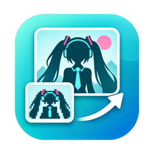
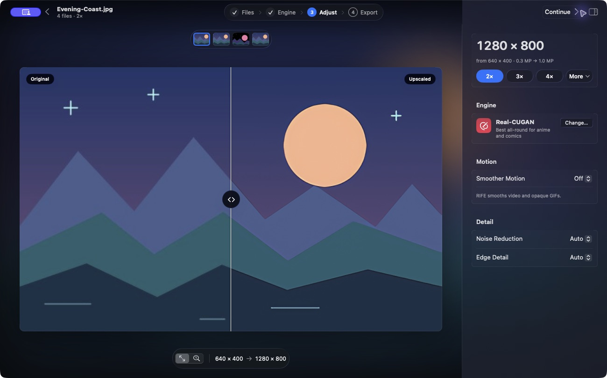
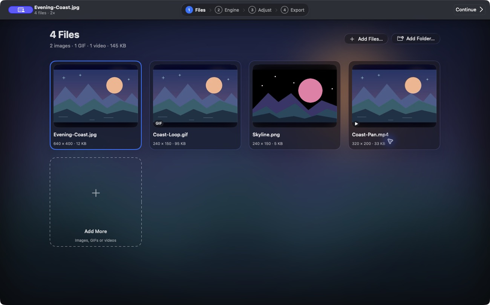
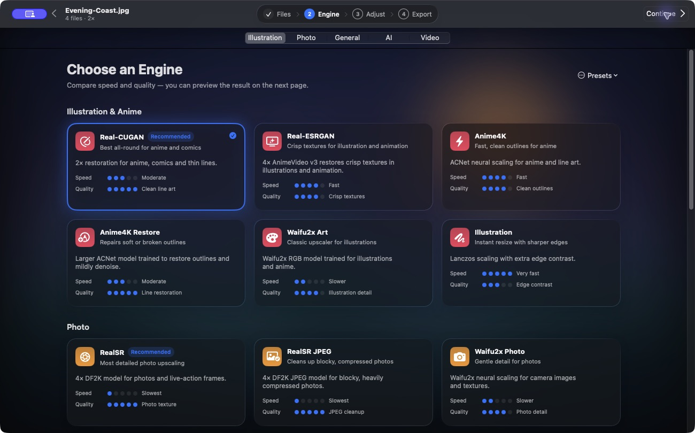
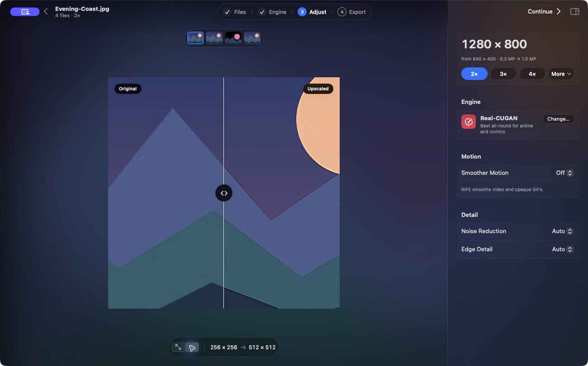
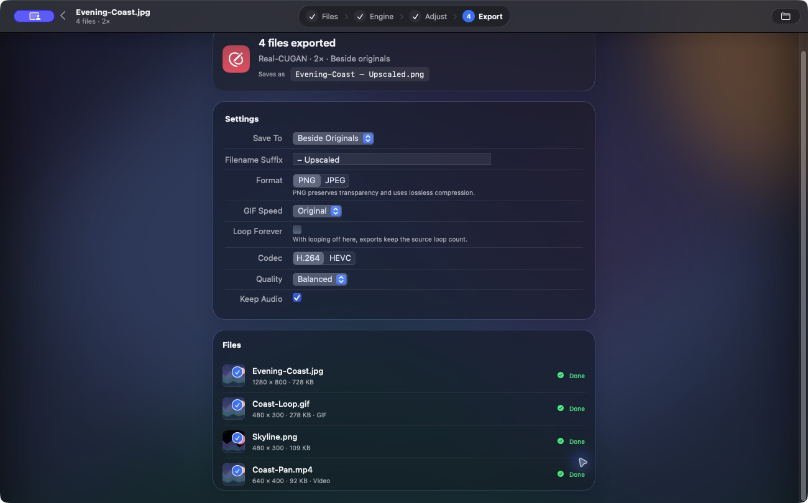

  

# Waifu2x-Mac

**Give small images, GIFs, and videos a little more room.**

An on-device upscaler for Apple Silicon Macs.

**[Build Waifu2x-Mac 2.8.0](docs/getting-started.md)**

[Get started](docs/start-here.md) · [Walkthrough](docs/walkthrough.md) · [Engines](docs/engines.md) · [Troubleshooting](docs/troubleshooting.md) · [Changelog](CHANGELOG.md)

Drop in a small illustration or a folder of clips. Pick an engine, drag the before-and-after divider, and check the pixels that matter before you export. The rebuild puts **Files**, **Engine**, **Adjust**, and **Export** in the window toolbar. You can jump back to a step without rebuilding the batch.

## What it does

| If you're working with… | Start here |
| --- | --- |
| Anime, line art, or comics | Pick **Real-CUGAN** at **2×**. Leave **Noise Reduction** on Auto or Low and check thin strokes in **Actual Pixels**. |
| Photos or live action | Compare **RealSR** and **RealSR JPEG** on faces, hair, and edges. The JPEG model is useful when compression blocks are visible. |
| A quick resize | Choose **Fast**. It uses MetalFX where supported and Lanczos for other inputs. |
| GIFs or videos | Choose an upscaler, then use **Adjust → Smoother Motion** to try RIFE on eligible material. **NanoVSR** and **NanoVSR Detail** use neighboring frames for low-resolution video. |
| A wallpaper or a fixed size | Open **More** beside the scale buttons. Pick **4K**, **Portrait**, or **Custom** and check **Keep Aspect Ratio**. |
| A still or GIF that needs heavier restoration | Try the optional **FLUX.2 klein Restore** engine. Click **Preview AI** to see its edits before exporting. |

The bundled engines work offline. FLUX downloads once and runs on your Mac after installation. [Engine guide](docs/engines.md) · [AI Restore guide](docs/optional-engines.md)

## Get it running

The native **2.8.0** build targets Apple Silicon and macOS 15 or later. Build it from the Swift source checkout with Xcode and the macOS 26 SDK. The [build guide](docs/getting-started.md) covers the first launch, and [Builds & platform status](docs/releases.md) links to the published 1.0.1 source preview and explains which instructions apply to each build.

1. Drag in one PNG or JPEG or click **Choose Files…**.
2. Open **Engine** and select **Real-CUGAN** for the [sample illustration](docs/walkthrough.md).
3. In **Adjust**, choose **2×** and drag the divider. Switch to **Actual Pixels** to inspect a crop.
4. In **Export**, set **Save To** and click **Export**. When the job finishes, click **Show in Finder**.

<strong>See the four screens</strong>

*Captured in the native 2.8.0 app using synthetic sample media.*

## Documentation

| Start here | Recipes and settings | Reference |
| --- | --- | --- |
| [New to upscaling?](docs/start-here.md) | [Images and wallpapers](docs/images.md) | [Builds and platform status](docs/releases.md) |
| [Build and first run](docs/getting-started.md) | [GIFs and video](docs/motion.md) | [Troubleshooting](docs/troubleshooting.md) |
| [Your first upscale](docs/walkthrough.md) | [Engines and models](docs/engines.md) | [FAQ and glossary](docs/faq.md) |
| [Privacy, storage, and updates](docs/privacy.md) | [Size, presets, and output](docs/settings.md) | [Architecture and source map](docs/architecture.md) |
| [Development and tests](docs/development.md) | [Advanced settings](docs/advanced.md) · [AI Restore](docs/optional-engines.md) | [Packaging and signing](docs/packaging.md) |

The [docs site](https://aiden0rchad.github.io/Waifu2x-Mac/) has full-text search, a guide sidebar, and light and dark themes.

Found a bug? Share the app version, macOS version, Mac chip, engine and settings, and the smallest sample that reproduces it. [Open an issue](https://github.com/aiden0rchad/Waifu2x-Mac/issues/new/choose) · [Contributing](.github/CONTRIBUTING.md)

## Licensing

The native Swift app is licensed under AGPL 3.0. Bundled models and optional downloads retain their upstream terms and attribution. [App license](LICENSE) · [Bundled model notices](docs/models.md) · [Optional engine licenses](docs/optional-engines.md#downloads-and-licenses)
