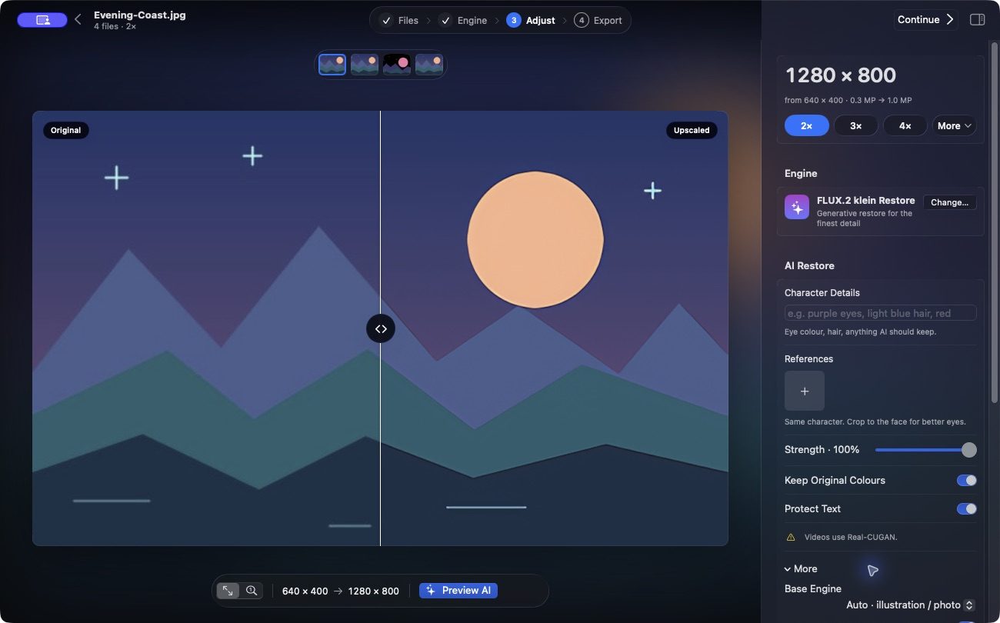
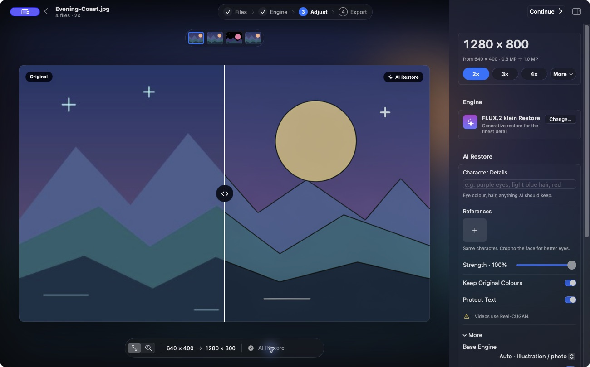
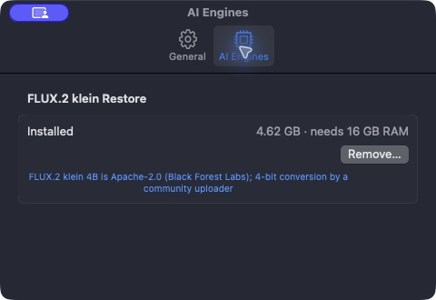

# Advanced settings

The controls live where you use them. The **Adjust** inspector handles restoration and motion, **Export** handles file settings, and **Waifu2x-Mac → Settings** handles app preferences.

## Adjust inspector

Click the inspector button at the top right or press **⌥⌘I** to show it.

| Control | What it changes |
| --- | --- |
| **Noise Reduction** | Selects a Real-CUGAN denoise checkpoint. Other eligible image engines use a separate filter. **Auto** selects Low for Real-CUGAN. |
| **Edge Detail** | Adds luminance sharpening after scaling for opaque inputs. |
| **Smoother Motion** | Adds intermediate frames on eligible GIF or video sources. [Motion options and limits](motion.md#smooth-motion) |
| **Change…** | Opens **Engine** to choose a different model. |

## AI Restore controls

With **FLUX.2 klein Restore** selected, the inspector shows **Character Details**, **References**, **Strength**, **Keep Original Colours**, and **Protect Text**. Open **More** under **AI Restore** for **Base Engine**, **Safety Check**, **Seed**, and **Prompt**. This is separate from the **More** menu beside the output scale.

**Preview AI** runs a local render. In this example it made the edges darker and changed the moon’s tone. Compare the result and use **Strength** to dial back edits.

[AI Restore setup and guidance](optional-engines.md)

## App settings

Open **Waifu2x-Mac → Settings**, or press **⌘,**.

- **General** controls whether to reveal completed files and keep the Mac awake during a run. It also clears recent export entries and reports support for Apple’s optional system engines.
- **AI Engines** shows download status and disk usage for FLUX. Install, pause, resume, or remove the optional engine here.

