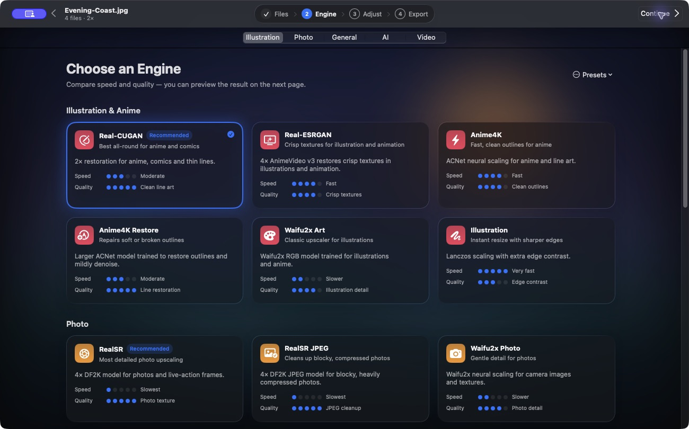
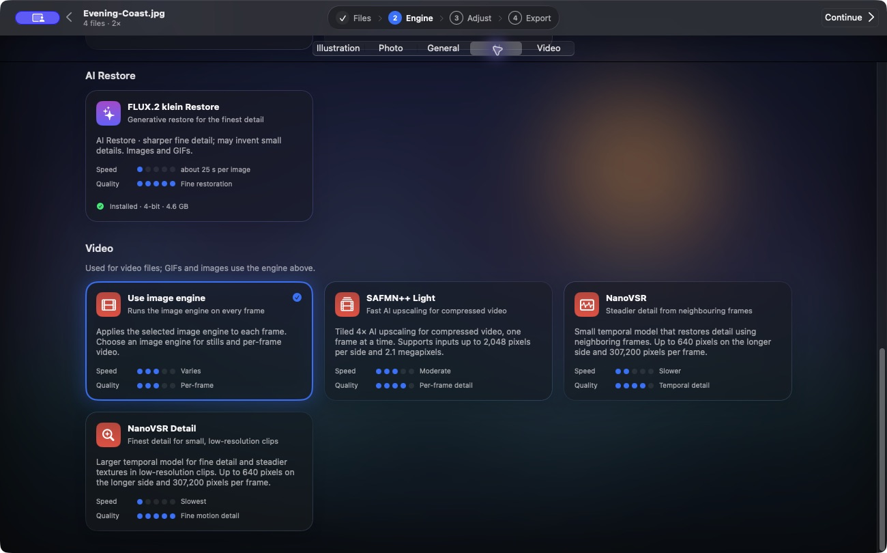

# Engines and models

Open **Engine** to browse the **Illustration**, **Photo**, **General**, **AI**, and **Video** sections. Each card shows what it works well on, plus relative speed and quality. The ratings help you pick a starting point. Image size, content, and hardware affect the result.

## Images and GIF frames

| Engine | Good starting point |
| --- | --- |
| **Real-CUGAN** | Anime, comics, flat color, and thin lines. Start at 2× with Auto or Low noise reduction. |
| **Real-ESRGAN** | The AnimeVideo v3 model for crisp textures in illustration and animation. Check edges and small text for oversharpening. |
| **Anime4K** / **Anime4K Restore** | ACNet for outlines. Restore uses a larger model trained on degraded inputs. |
| **Waifu2x Art** / **Waifu2x Photo** | The art model for drawn lines and the photo model for camera textures. |
| **RealSR** / **RealSR JPEG** | Compare the clean DF2K model and the JPEG model on portraits, textured photos, and compressed live-action frames. |
| **Fast** | MetalFX spatial resizing where supported, with Lanczos for other inputs. |
| **Illustration** / **Photo** | Quick Lanczos options with edge contrast or light noise reduction on opaque input. |
| **Apple ML** | Apple’s super resolution on supported opaque inputs and Macs running macOS 26 or later. Other inputs use Lanczos. |

For transparent inputs, the bundled neural image path uses Lanczos to keep alpha. The app can chain native 2× passes for larger targets. Real-CUGAN denoises on the first pass and uses the scale-only model for subsequent passes. If another pass would exceed the working-size limit, the app finishes with Lanczos.

## Video

The **Video** section appears for batches with video. The selected video engine applies to clips. The image engine applies to stills and GIFs and also to video when you choose **Use image engine**.

| Video engine | When to pick it |
| --- | --- |
| **Use image engine** | Apply the same spatial upscaler to each frame. |
| **SAFMN++ Light** | Per-frame 4× model for compressed footage. Supports input up to 2,048 px per side and 2.1 MP per frame. |
| **NanoVSR** | Temporal upscaling for small clips where nearby frames help recover detail. |
| **NanoVSR Detail** | A larger temporal checkpoint for small clips. Both NanoVSR variants accept 8–640 px per side and up to 307,200 pixels per frame. |

Use **Adjust → Smoother Motion** for **RIFE 4.6** or, on supported Macs, **Apple VideoToolbox**. The NanoVSR engines preserve source cadence. [Motion and format limits](motion.md)

## Optional AI Restore

**FLUX.2 klein Restore** is a downloadable 4-bit model for images and GIFs. It can change colors, outlines, or fine details. Compare a **Preview AI** result with the input before exporting. [Install and use AI Restore](optional-engines.md)

[Checkpoint provenance and license notices](models.md)
