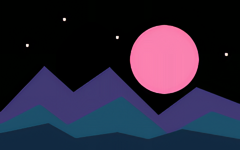

# Images and wallpapers

Try one file before processing an album. Keep the source, inspect a crop in **Adjust**, and open the exported image to see the result at its final size.

## Anime and line art

1. On **Engine**, pick **Real-CUGAN** or **Anime4K**.
2. In **Adjust**, select **2×**. For Real-CUGAN, **Auto** uses Low denoise. Pick **Off** to keep the most texture or increase to **Medium** or **High** for obvious noise.
3. Inspect fine outlines and lettering with **Actual Pixels**. If the model softens the lines, reduce denoise or try **Real-ESRGAN** for a different result.
4. Pick **PNG** in **Export** for lossless output and alpha.

| Original, 240 × 150 | Real-CUGAN at 2×, 480 × 300 |
| --- | --- |
|  |  |

[Download the input PNG](https://raw.githubusercontent.com/aiden0rchad/Waifu2x-Mac/main/docs/assets/skyline.png)

## Photos and portraits

Choose **RealSR** for fine texture. If the original has visible compression blocks or ringing, compare **RealSR JPEG**. Use **Waifu2x Photo** for gentler restoration. Check hair, skin, and edges in Actual Pixels. Keep **Edge Detail** low if you see halos. [Engine guide](engines.md)

## Fit a wallpaper

In **Adjust**, open **More** beside the scale controls. Pick **4K** for a 3840 × 2160 target, **Portrait** for 1080 × 1920, or **Custom**. With **Keep Aspect Ratio** on, the image fits within the target and one dimension can be smaller. Switch it off if you specifically want to stretch to the exact dimensions. Read the output size above the scale controls.

## Restore a degraded still

For larger changes, download **FLUX.2 klein Restore**, select it, and use **Preview AI**. Compare the output around text and faces. Lower **Strength** to mix more of the base result back in. [AI Restore controls and limits](optional-engines.md)
