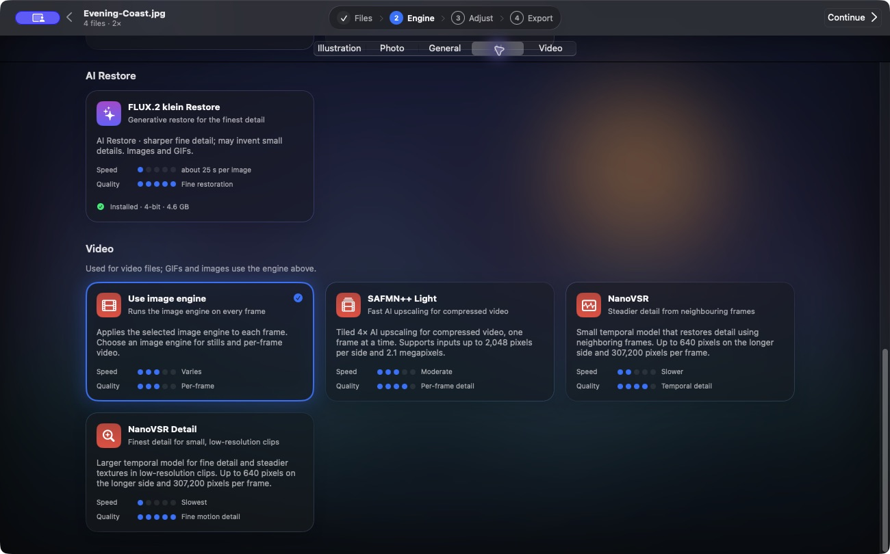

# GIFs and video

Start with a short clip or a small GIF. Choose an engine in **Engine**, check the preview in **Adjust**, then set the file format options in **Export**. The preview is a still sample, so open the exported file to judge motion.

## Animated GIF

1. Add the GIF in **Files** and pick an image engine such as **Real-CUGAN**.
2. In **Adjust**, choose a size. For opaque GIF frames, optionally choose **RIFE 4.6** under **Smoother Motion**.
3. In **Export**, leave **GIF Speed** on **Original** to keep the playback speed. **½×** plays more slowly and **2×** plays faster. **Loop Forever** overrides the source loop count.
4. Open the resulting GIF and check a few loops, especially around transitions and small text.

Transparent GIF frames keep alpha. RIFE skips pairs with transparency, different frame dimensions, or adjusted frame delays under 0.04 seconds. FLUX.2 klein Restore is a separate option for restoring GIF frames. It keeps timing and transparency and reuses results for identical frames. [AI Restore for GIFs](optional-engines.md#animated-gifs)

## Video

Under **Engine → Video**, choose **Use image engine** for per-frame scaling, **SAFMN++ Light** for compressed footage up to 2,048 px per side and 2.1 MP, or **NanoVSR** for smaller clips. Both NanoVSR variants accept up to 640 px per side and 307,200 pixels per frame. **NanoVSR Detail** uses a larger model. [Engine guide](engines.md#video)

In **Export**, pick **H.264** or **HEVC** and choose an encoder **Quality**. **Keep Audio** retains the first audio track as AAC. MP4 output is SDR. The video pipeline handles portrait orientation and rounds output dimensions up to even numbers, with a 4,096 px limit per side.

## Smooth motion

In **Adjust**, open the inspector and choose **Smoother Motion**.

| Choice | Effect |
| --- | --- |
| **Off** | Keeps source cadence. |
| **RIFE 4.6** | Generates a frame between adjacent source frames on eligible video and opaque GIFs. Source frames are limited to 1,920 px per side and 2,073,600 pixels. |
| **Apple VideoToolbox** | Interpolates video on supported Macs with macOS 26 or later. Check **Settings → General** for availability. |

Use motion interpolation with a per-frame video engine. NanoVSR preserves source cadence. When FLUX is selected for GIFs, those GIFs keep their source frames, and the separate video motion setting can still apply to eligible videos in the batch. Inspect fast movement, scene cuts, captions, and overlapping objects for artifacts.

