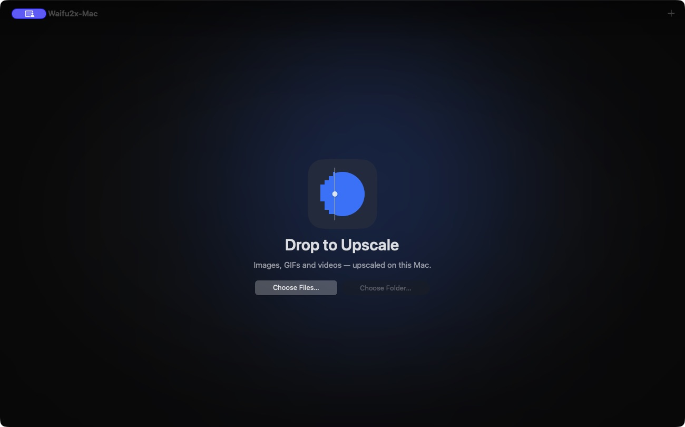

# Start here

Waifu2x-Mac runs on Apple Silicon. It makes small images, animated GIFs, and video frames larger using a choice of local engines. An upscale can clean up rough lines and compression artifacts, but the engine may also smooth away fine detail or draw new texture. Compare one sample before processing a folder.

## Choose a path

| What you want to do | Where to go |
| --- | --- |
| Build and open the native app | [Build and first run](getting-started.md) |
| Get a quick result from an image | [Upscale your first file](walkthrough.md) |
| Clean up a photo or make a wallpaper | [Images and wallpapers](images.md) |
| Improve a GIF or clip | [GIFs and video](motion.md) |
| Use generative restoration | [Optional AI Restore](optional-engines.md) |
| See which build these docs cover | [Builds and platform status](releases.md) |

## The four pages

| Page | What you do there |
| --- | --- |
| **Files** | Add images, GIFs, or videos and check the file cards. |
| **Engine** | Compare engines by source type, speed, and quality. A batch can have a separate video engine. |
| **Adjust** | Pick a size and tune the inspector. Use the filmstrip and divider to compare files or zoom into **Actual Pixels**. |
| **Export** | Set the destination and formats, run the batch, and open finished files. |

Use **Continue** or the steps in the toolbar to move between pages. The first preview of a model can take a little longer while macOS prepares it.
