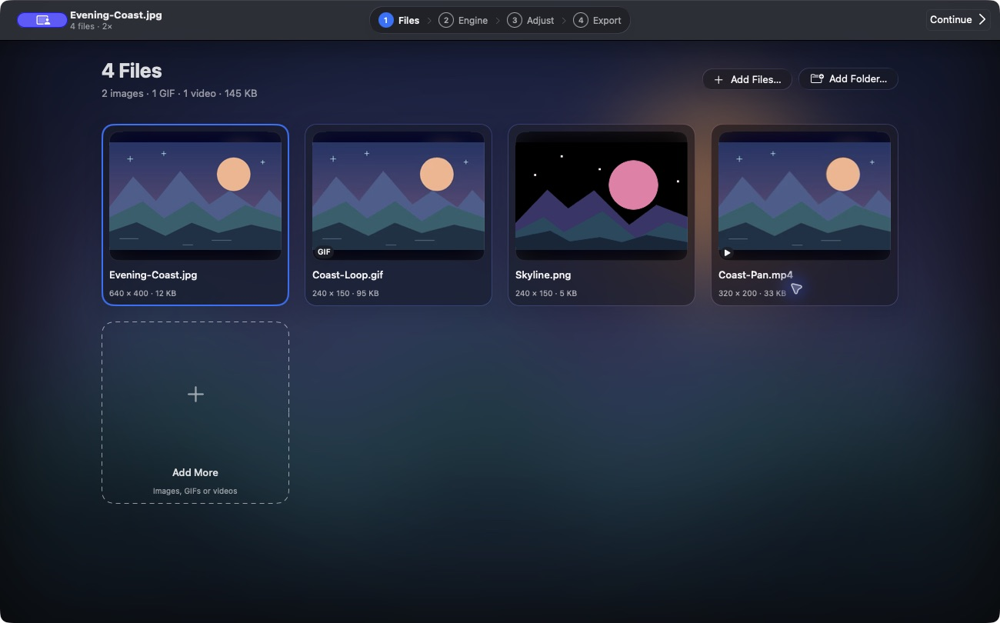
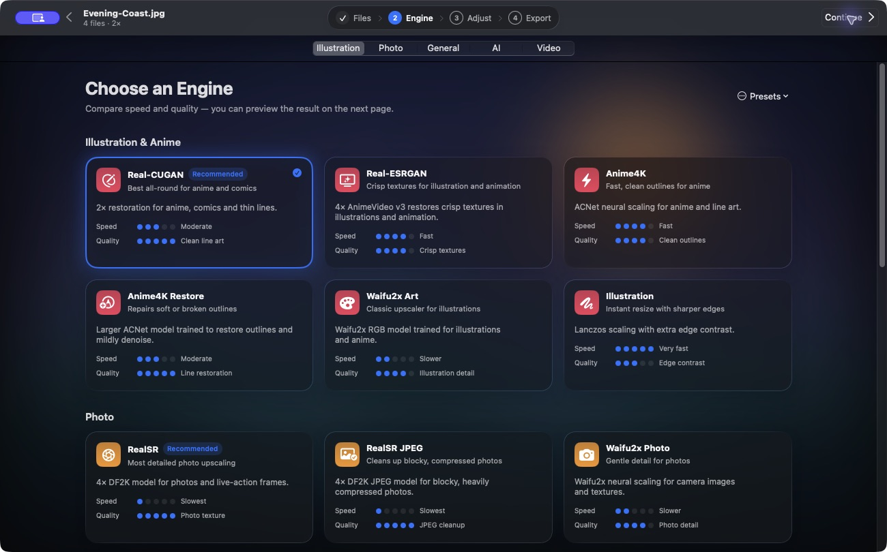
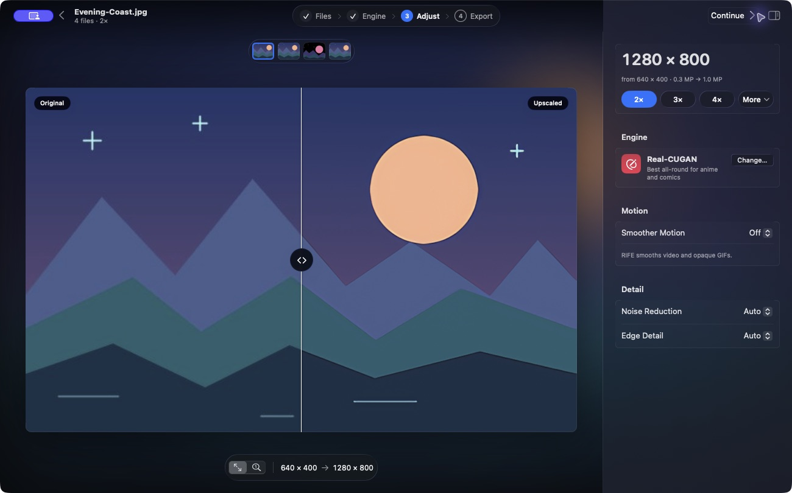
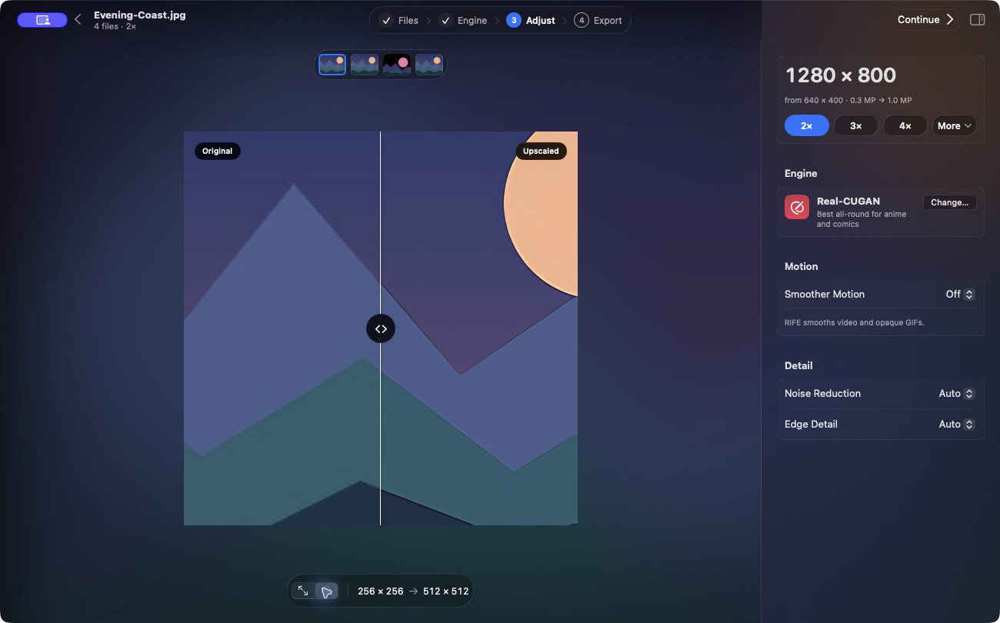
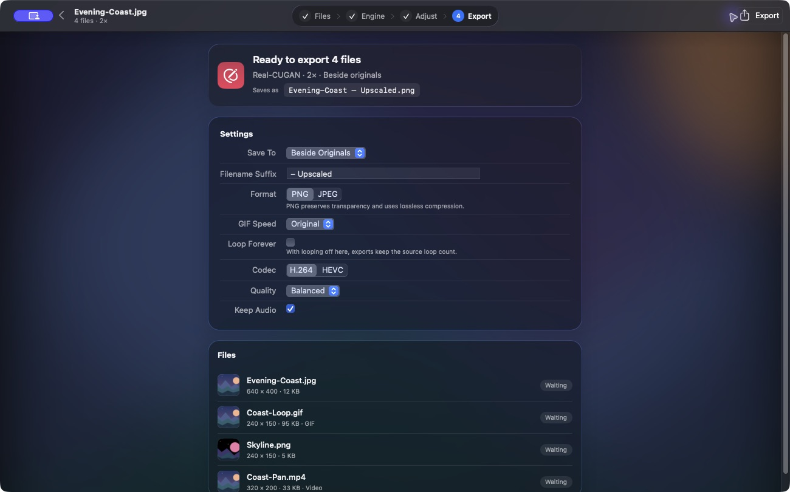
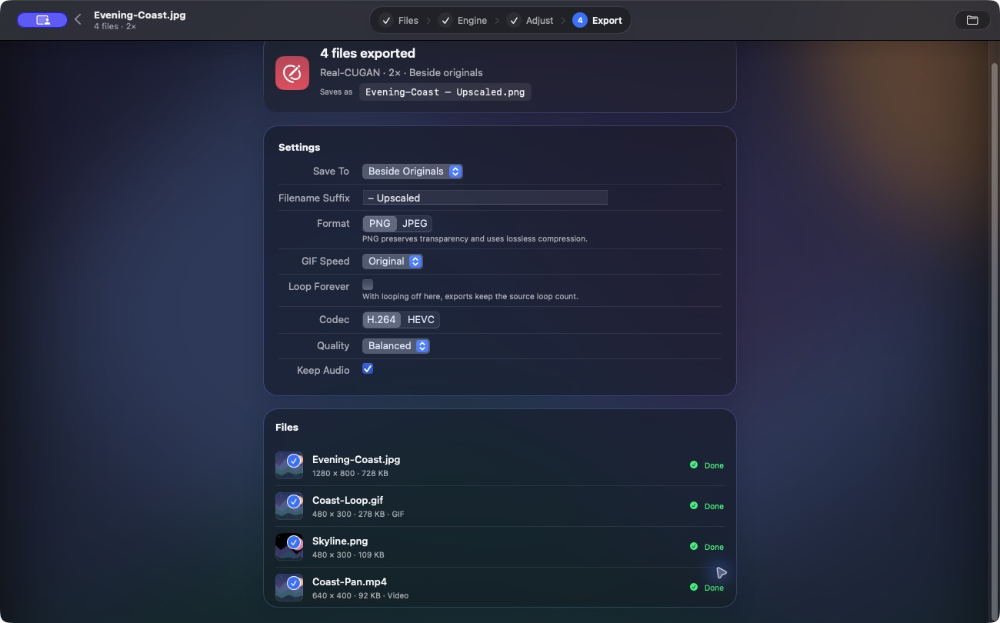

# Upscale your first file

Start with one small PNG or JPEG. The [sample skyline PNG](https://raw.githubusercontent.com/aiden0rchad/Waifu2x-Mac/main/docs/assets/skyline.png) is 240 × 150 pixels. At **2×**, it exports at 480 × 300. You can try the same workflow on any of your own files.

## 1. Files

Drop your image into the window or click **Choose Files…**. Use **Choose Folder…** to add supported media from a folder. Once the batch is loaded, **Files** shows a card with the type, dimensions, and size of each item. Double-click a card to open that file in **Adjust**. For a first run, click **Continue** to pick an engine.

## 2. Engine

Under **Illustration & Anime**, choose **Real-CUGAN**. Pick **Fast** from **General** if you just want a quick resize. The circles on each card compare relative speed and quality for that engine’s intended material. For a mixed batch, use the **Video** section to choose how clips are upscaled. Continue to **Adjust**.

## 3. Adjust

1. Choose **2×** in the inspector. The large number at the top shows the output dimensions. To fit a particular size, choose **More** beside **4×**.
2. Drag the divider over a line or an edge. Click **Original** or **Upscaled** to see one side by itself. For a batch, switch the sample using the filmstrip.
3. In **Fit**, click a point on the image to choose a detail region. Use **Actual Pixels** in the bar under the canvas, or press **⌘2**, to inspect the corresponding export pixels. Press **⌘1** to return to Fit. In the focused detail canvas, arrow keys move the inspection region.
4. Leave **Noise Reduction** on **Auto** for the first run. For Real-CUGAN, this uses its Low denoise model. Compare before going higher.

Fit can use a smaller sample for responsiveness. Actual Pixels uses the selected crop at its export scale. Video and GIF previews show a still sample. Review exported motion on the clip itself.

## 4. Export

Choose **Beside Originals** or **Folder…** under **Save To**. Review the filename suffix and choose **PNG** or **JPEG** for stills. GIF and video settings appear when those types are in the batch.

Click **Export**. Follow the batch progress in the toolbar and the status beside each file. When it finishes, use **Show in Finder**, or right-click an output row to open or reveal that result. Check the exported dimensions before running the same settings on a bigger batch.

Next try [images and wallpapers](images.md), [GIFs and video](motion.md), or [AI Restore](optional-engines.md).
