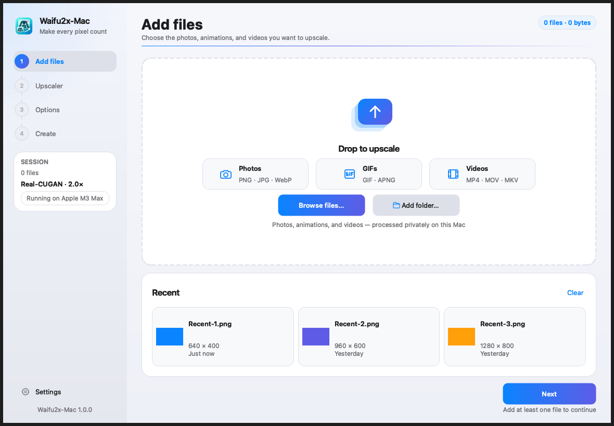
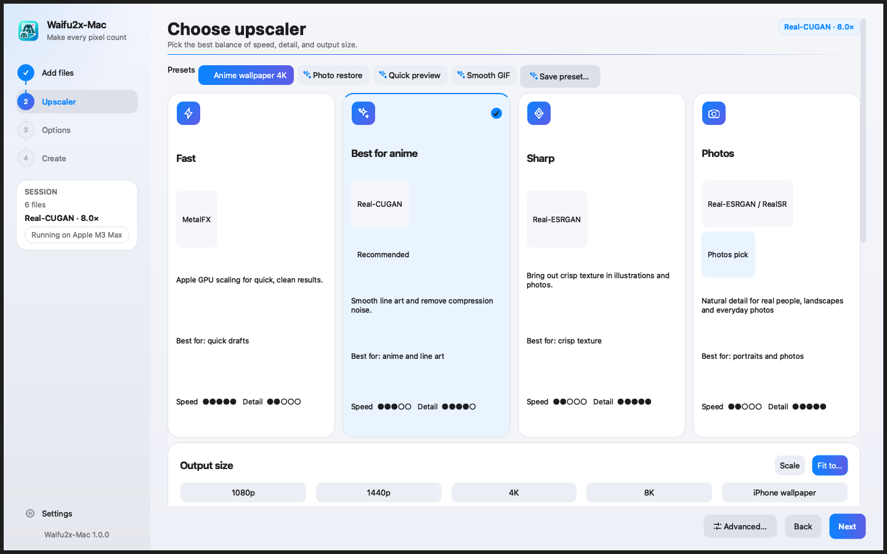
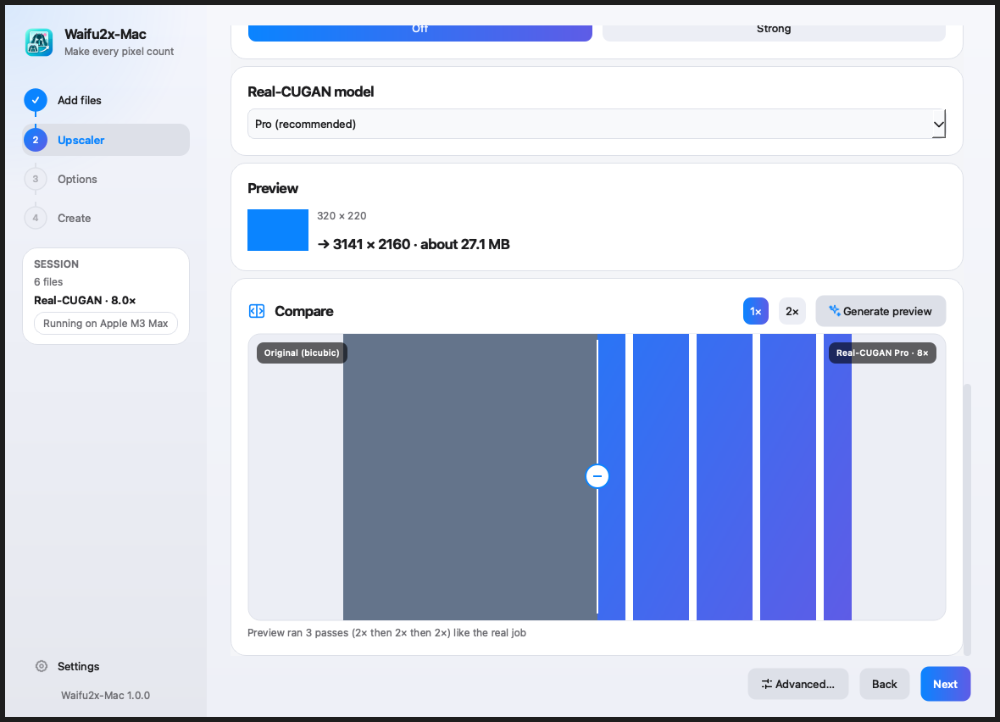
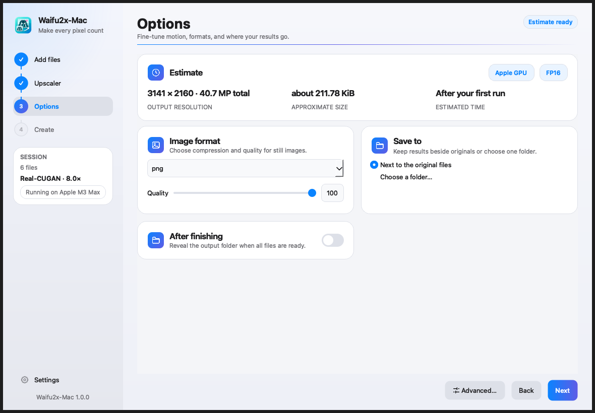
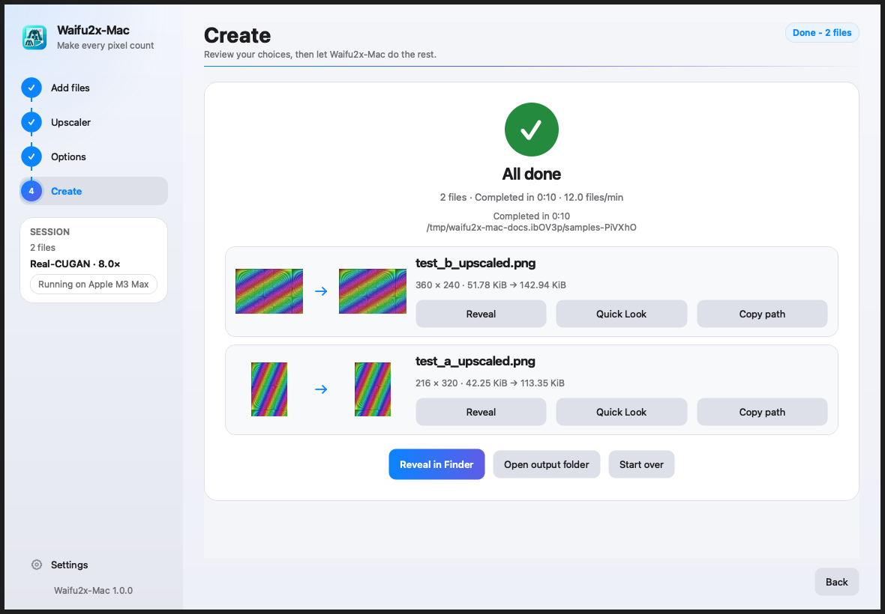

# Upscale your first file

Use a small PNG or JPEG. The [example skyline PNG](https://raw.githubusercontent.com/aiden0rchad/Waifu2x-Mac/main/docs/assets/skyline.png) is 240 × 150, so a **2×** run should give you 480 × 300. Doubling both dimensions quadruples the pixel count.

## 1. Add files

Drag files into the drop area or use **Browse files…**. A batch can contain images, animated GIFs, and videos. Check the displayed dimensions and file types before continuing. Use a short clip for your first video test.

## 2. Choose an upscaler and compare

Start with **MetalFX** and **2×** for a quick run, or choose **Real-CUGAN** for drawn lines and flat colors. Use the live before/after divider to inspect edges, small text, or faces. For a batch, the comparison samples one file or frame. Check the final outputs for changes across the entire batch.

Choose **Fit to…** when you know the dimensions you want. The aspect-ratio controls determine how the source fits the target. A 4:3 source and a 16:9 target require a tradeoff between fitting or stretching, so check the preview before committing to a long run.

## 3. Set the output

In **Options → Save to**, choose a folder with room for the new files. Keeping output in a separate folder makes it easier to check a batch. In **Advanced settings → Output**, review format and naming. For GIFs and videos, test **Smoother motion** on a short clip after the plain upscale works. Interpolation adds frames and takes extra processing time.

## 4. Create and review

In **Create**, review the summary and start the job. For video, allow time for frame extraction, upscaling, and encoding. Open finished files from the results gallery or reveal the output folder. Compare a few edges or frames at normal viewing size and inspect any failed items before rerunning them.

*Screenshots show the app with demo data. The preview and gallery are illustrative.*

Next try [images and wallpapers](images.md) or [GIFs and video](motion.md). If an output is missing, see [Troubleshooting](troubleshooting.md).
